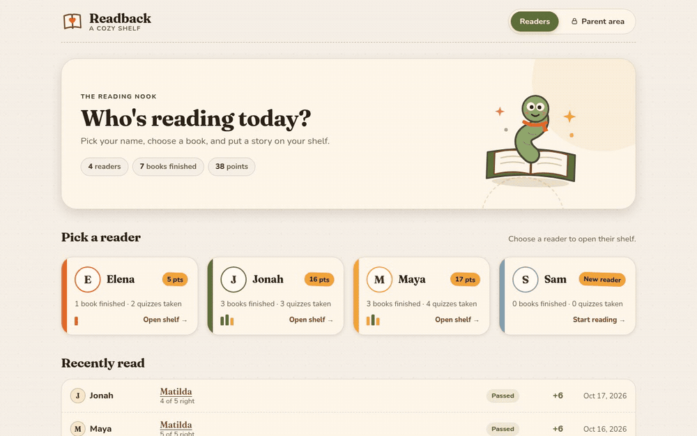
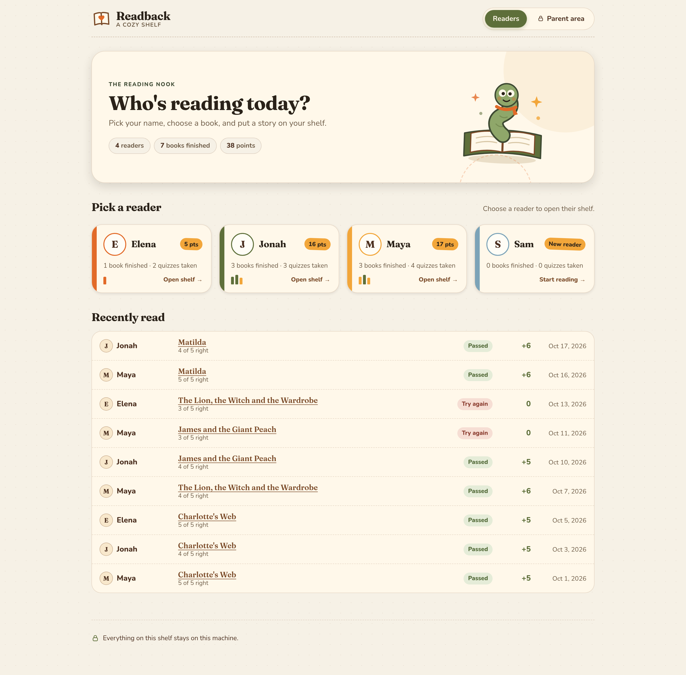
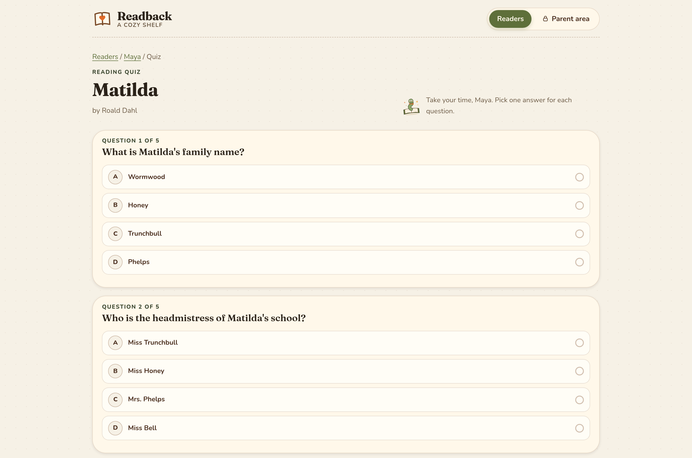
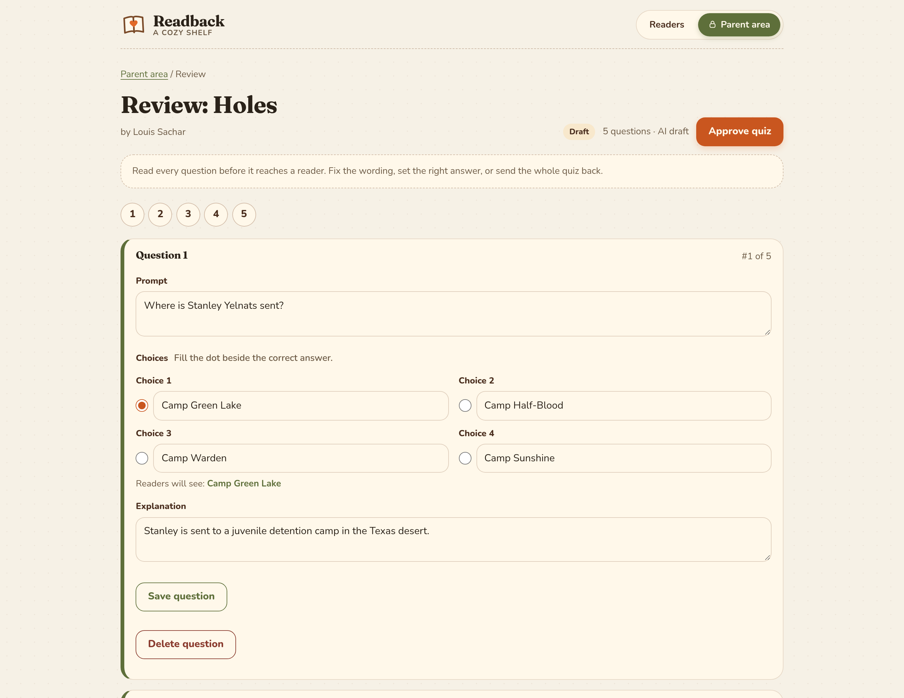
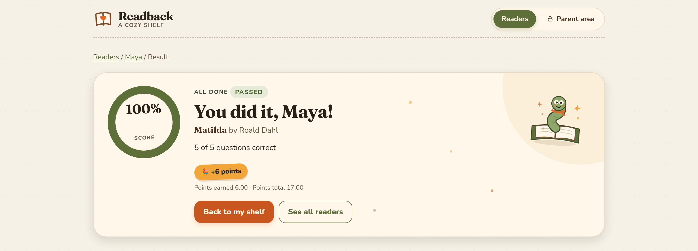

# Readback

Self-hosted reading comprehension and points tracking for families.

Readback keeps a book list, generates short multiple-choice quizzes from book
metadata, holds every generated quiz for parent review, and records reader
attempts and points in a local SQLite database.

It has two surfaces: a light, playful shelf for young readers, and a calmer
grown-ups' corner for approving quizzes and managing the library.

<p align="center">
  
</p>

Readback is not affiliated with Renaissance Learning or Accelerated Reader. It
generates original questions. It does not contain or copy proprietary quiz
content, and it never contacts Renaissance Learning services.

## What it does

- Stores readers, books, quizzes, attempts, and a points ledger in one SQLite file.
- Imports a book list from CSV and enriches ISBNs through Open Library on demand.
- Asks an OpenAI-compatible chat endpoint to draft quiz questions for a book.
- Requires a parent to review, edit, and approve each quiz before readers see it.
- Scores attempts, awards a book's points once per reader, and exports the
  reading log as CSV.
- Serves a small server-rendered web interface with no JavaScript required.

Readback does not include a language model. You point it at one you run or
subscribe to, for example Ollama or LM Studio on the same machine.

## What it looks like

<p align="center">
  
</p>

| Taking a quiz | Parent review |
| --- | --- |
|  |  |

<p align="center">
  
</p>

## Quick start

Python 3.10 or newer is required.

```bash
python -m venv .venv
.venv/bin/pip install -e '.[dev]'
.venv/bin/readback init-db
.venv/bin/readback import-books examples/books.example.csv
.venv/bin/readback serve
```

Open http://127.0.0.1:5057. The parent area is at `/parent`.

To use a different database file or model endpoint, set the environment
variables listed below before running `serve`.

### Try it without a model

The repo ships a demo seeder with curated questions, so you can look around
before wiring up a model endpoint:

```bash
.venv/bin/python scripts/seed_demo.py --db demo.db --force
READBACK_DB=demo.db .venv/bin/readback serve
```

The demo creates four readers, five approved quizzes, one draft waiting for
review, and nine attempts with points already awarded.

### Docker

```bash
docker build -t readback .
docker run -d --name readback -p 127.0.0.1:5057:5057 \
  -v readback-data:/data \
  -e READBACK_LLM_BASE_URL=http://host.docker.internal:11434/v1 \
  readback
```

The image runs as an unprivileged user, stores its database at
`/data/readback.db`, and listens on port 5057. On Linux,
`host.docker.internal` may need to be replaced with the host's address on the
Docker bridge, or run with `--network=host`.

## Configuration

All settings come from environment variables. Only the database path has a
value that affects where your data lives; everything else has a working
default for a local setup.

| Variable | Default | Meaning |
|---|---|---|
| `READBACK_DB` | `./readback.db` | SQLite database file. |
| `READBACK_HOST` | `127.0.0.1` | Web bind address for `readback serve`. |
| `READBACK_PORT` | `5057` | Web port. |
| `READBACK_LLM_BASE_URL` | `http://localhost:11434/v1` | OpenAI-compatible API base URL. |
| `READBACK_LLM_API_KEY` | empty | Bearer token. Leave empty for local models. |
| `READBACK_LLM_MODEL` | `llama3.1:8b` | Model name sent to the endpoint. |
| `READBACK_LLM_TIMEOUT` | `120` | Seconds to wait for a completion. Raise it for large local models on CPU. |
| `READBACK_PASS_THRESHOLD` | `0.8` | Fraction of correct answers needed to pass, greater than 0 and at most 1. |
| `READBACK_PARENT_PIN` | empty | When set, `/parent/*` requires this PIN. |
| `READBACK_SECRET_KEY` | random per process | Flask session signing key. Set it to keep parent sessions across restarts. |

### Ollama

Pull a model, start Ollama, and point Readback at its OpenAI-compatible API:

```bash
ollama pull llama3.1:8b
ollama serve

export READBACK_LLM_BASE_URL=http://localhost:11434/v1
export READBACK_LLM_API_KEY=
export READBACK_LLM_MODEL=llama3.1:8b
```

Local models on CPU can take a few minutes to produce a quiz. If the request
times out, raise `READBACK_LLM_TIMEOUT` or use a smaller model.

### LM Studio

In LM Studio, load a model and start the local server (Developer tab). The
default port is 1234:

```bash
export READBACK_LLM_BASE_URL=http://localhost:1234/v1
export READBACK_LLM_API_KEY=
export READBACK_LLM_MODEL=your-loaded-model-name
```

Any other server that implements `POST /chat/completions` with a
`response_format` of `{"type": "json_object"}` also works. If the endpoint
rejects `response_format` with a 4xx response, Readback retries once without it.

## Book CSV format

The importer reads a header row. Header names are matched case-insensitively,
and `grade level` is treated the same as `grade_level`. Only `title` is
required; missing columns and blank cells become empty values.

| Column | Required | Notes |
|---|---|---|
| `title` | yes | Book title. |
| `author` | no | Author name. |
| `isbn` | no | Used to match an existing book on re-import. |
| `points` | no | Non-negative number, `0` when blank. |
| `grade_level` | no | Free text, for example `4-6`. |
| `notes` | no | Parent notes. These are included in the quiz prompt, so keep them about the book, not about the reader. |

Sample row:

```csv
title,author,isbn,points,grade_level,notes
Charlotte's Web,E.B. White,9780064400558,5.0,4-6,Friendship and farm life
```

See `examples/books.example.csv` for a full file. Re-importing a book matches
it by ISBN first, then by title and author, and updates the existing row.

## Parent approval workflow

1. Add a reader in the parent area.
2. Import books at `/parent/books`.
3. Press "Generate quiz" for a book. Readback asks the configured model endpoint
   for a draft and saves it with status `draft`. A book has at most one draft at
   a time; generating again replaces the previous draft.
4. Open the draft at `/parent/quiz/<id>`. Every question appears in an editable
   form with its four choices, correct answer, and explanation. You can fix
   wording, change the answer, delete a question, or reject the whole quiz.
5. Approve the quiz. Approval is refused when the quiz has no questions or any
   question is structurally invalid, and the reasons are shown on the page.
6. Only approved quizzes appear on a reader's page. Readers can retake quizzes,
   but a reader earns a book's points only once, on the first passing attempt.
   Later passing attempts score normally and award nothing.

The parent pages require a PIN only when `READBACK_PARENT_PIN` is set. The
reader pages and the dashboard are always open.

## Privacy

Readback has no accounts, telemetry, analytics, or cloud component. Readers,
books, quizzes, attempts, and points stay in the SQLite file you configure.

When you press "Generate quiz", Readback sends one HTTP request to
`READBACK_LLM_BASE_URL`:

- The model name from `READBACK_LLM_MODEL`.
- A prompt containing the book's title, author, grade level, points value, and
  parent notes, plus instructions to return strict JSON.
- The `Authorization: Bearer` header only when `READBACK_LLM_API_KEY` is set.

Readback does not send book text, reader names, attempt history, or points
totals. There is no book text ingestion in this version at all. The request goes
to whatever endpoint you configure: a local process keeps it on your machine,
while a hosted endpoint receives the metadata above. Readback does not contact
Open Library or any other service on its own.

## Security warning for LAN use

Readback has no user accounts, no login for readers, and no transport
encryption. Anyone who can reach the port can read the reading log, take
quizzes, create readers, and, unless a PIN is set, use the parent area.

- The default bind address is `127.0.0.1`, so only the local machine can connect.
- `readback serve --host 0.0.0.0` or `READBACK_HOST=0.0.0.0` exposes it to your
  local network. On a trusted home network that may be what you want. On an
  untrusted network, do not do it.
- Do not expose Readback directly to the internet. If you need remote access,
  put it behind a VPN or an authenticating reverse proxy with TLS, and set
  `READBACK_PARENT_PIN` and `READBACK_SECRET_KEY`.
- The PIN protects only the parent pages. It does not encrypt traffic and does
  not protect reader pages.

## Running the tests

```bash
.venv/bin/pytest -q
```

Tests use temporary databases and a fake model client. They do not touch the
network and do not write to `readback.db`.

## License

MIT. See [LICENSE](LICENSE).
